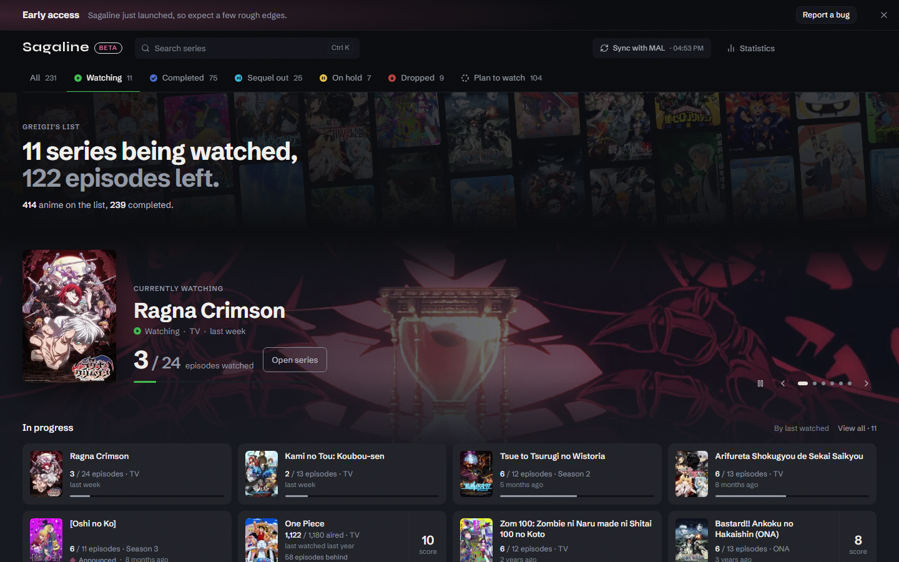

  

🇬🇧 English · <a href="README_TR.md">🇹🇷 Türkçe</a> · <a href="README_ES.md">🇪🇸 Español</a>

<h1 align="center">Sagaline</h1>

  <b>Your MyAnimeList, one card per series.</b> 
  Seasons, OVAs and movies grouped in release order, with your next episode up front.

  <a href="https://sagaline.app"><b>Open sagaline.app</b></a> ·
  <a href="https://github.com/efebadir/sagaline-releases/releases/latest/download/Sagaline_x64-setup.exe"><b>Download for Windows</b></a> ·
  <a href="https://sagaline.app/faq">FAQ</a>

  

## Why

On MyAnimeList every season, OVA, movie and special is its own entry. A long series turns into a dozen scattered rows, and it's easy to lose track of what comes next. Sagaline reads your list and puts each franchise on a single card, in release order.

- **One card per series.** Seasons, OVAs, movies and specials together, in the order they aired.
- **Your next episode, always in front.** No digging for where you left off.
- **Sequels and new seasons.** When a continuation is announced or airing, the card shows it.
- **Writes back to MAL, if you want.** Connect your MAL account and +1, Complete and Undo update your list. Without connecting, it only reads.
- **Free, no ads, no account.** Your list is read through the official MyAnimeList API and stays in your browser.

## Windows app

The Windows app opens Sagaline in its own window, so it lives on your taskbar instead of a browser tab.

1. [Download the installer](https://github.com/efebadir/sagaline-releases/releases/latest/download/Sagaline_x64-setup.exe) (about 3 MB, Windows 10/11, 64-bit).
2. Run it. The app isn't code-signed yet, so Windows SmartScreen may say *"Windows protected your PC"*. Click **More info → Run anyway**. Installation is per user and needs no admin rights.
3. Sign in with MyAnimeList from Settings. Sign-in opens in your normal browser and brings you back to the app.

The app updates itself: when a new version is out, it asks once and installs it.

Step-by-step guide with pictures: [sagaline.app/download](https://sagaline.app/download)

## About this repository

This repo holds the **Windows installers and the update feed** ([Releases](https://github.com/efebadir/sagaline-releases/releases)). The app's source code is private for now.

Found a bug or have an idea? Use [Report an issue](https://sagaline.app/report) on the site, or open an issue here.

If Sagaline helps you keep your list in order, a ⭐ helps other anime fans find it.

## Privacy

Your MyAnimeList password never reaches us; sign-in happens on MyAnimeList's own page. Lists are not stored on our servers. Details: [Privacy note](https://sagaline.app/privacy) · [Terms](https://sagaline.app/terms)

---

Sagaline is an independent fan project and is not affiliated with MyAnimeList. Anime data comes from MyAnimeList and AniList.
