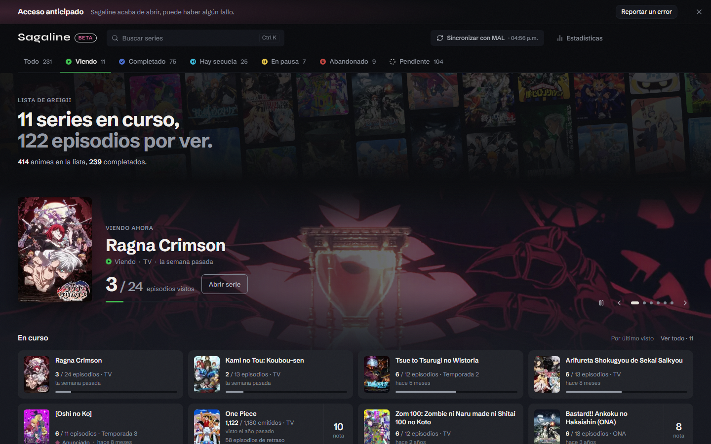

  

<a href="README.md">🇬🇧 English</a> · <a href="README_TR.md">🇹🇷 Türkçe</a> · 🇪🇸 Español

<h1 align="center">Sagaline</h1>

  <b>Tu MyAnimeList, una tarjeta por serie.</b> 
  Temporadas, OVAs y películas juntas en orden de emisión, con tu próximo episodio siempre delante.

  <a href="https://sagaline.app"><b>Abrir sagaline.app</b></a> ·
  <a href="https://github.com/efebadir/sagaline-releases/releases/latest/download/Sagaline_x64-setup.exe"><b>Descargar para Windows</b></a> ·
  <a href="https://sagaline.app/faq">Preguntas frecuentes</a>

  

## Por qué

En MyAnimeList cada temporada, OVA, película y especial es una entrada aparte. Una serie larga se convierte en una docena de filas sueltas y es fácil perder la pista de lo que sigue. Sagaline lee tu lista y pone cada franquicia en una sola tarjeta, en orden de emisión.

- **Una tarjeta por serie.** Temporadas, OVAs, películas y especiales juntos, en el orden en que se emitieron.
- **Tu próximo episodio, siempre delante.** Sin buscar dónde te quedaste.
- **Secuelas y nuevas temporadas.** Cuando se anuncia o se emite una continuación, la tarjeta lo muestra.
- **Escribe en MAL, si quieres.** Conecta tu cuenta de MAL y +1, Completar y Deshacer actualizan tu lista. Sin conectar, solo lee.
- **Gratis, sin anuncios, sin cuenta.** Tu lista se lee con la API oficial de MyAnimeList y se queda en tu navegador.

## App para Windows

La app para Windows abre Sagaline en su propia ventana, así vive en la barra de tareas y no se pierde entre pestañas.

1. [Descarga el instalador](https://github.com/efebadir/sagaline-releases/releases/latest/download/Sagaline_x64-setup.exe) (unos 3 MB, Windows 10/11, 64 bits).
2. Ejecútalo. La app aún no tiene firma de código, así que Windows SmartScreen puede decir *"Windows protegió su PC"*. Pulsa **Más información → Ejecutar de todas formas**. Se instala solo para tu usuario y no pide permisos de administrador.
3. Inicia sesión con MyAnimeList desde Ajustes. El inicio de sesión se abre en tu navegador y te devuelve a la app.

La app se actualiza sola: cuando sale una versión nueva, pregunta una vez y la instala.

Guía paso a paso con imágenes: [sagaline.app/download](https://sagaline.app/download)

## Sobre este repositorio

Este repositorio guarda los **instaladores para Windows y el canal de actualizaciones** ([Releases](https://github.com/efebadir/sagaline-releases/releases)). El código fuente de la app es privado por ahora.

¿Encontraste un error o tienes una idea? Usa [Reportar un error](https://sagaline.app/report) en la web o abre un issue aquí.

Si Sagaline te ayuda a ordenar tu lista, una ⭐ ayuda a que otros fans del anime la encuentren.

## Privacidad

Tu contraseña de MyAnimeList nunca nos llega; inicias sesión en la propia página de MyAnimeList. Las listas no se guardan en nuestros servidores. Detalles (en inglés): [Privacy note](https://sagaline.app/privacy) · [Terms](https://sagaline.app/terms)

---

Sagaline es un proyecto independiente de fans y no está afiliado a MyAnimeList. Los datos de anime vienen de MyAnimeList y AniList.
