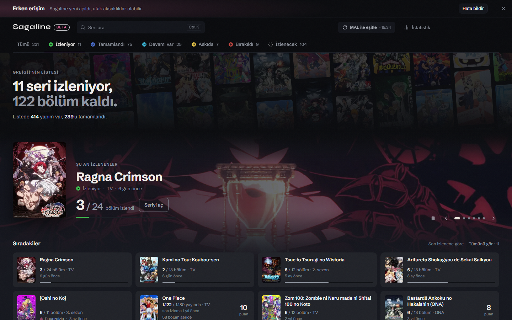

  

<a href="README.md">🇬🇧 English</a> · 🇹🇷 Türkçe · <a href="README_ES.md">🇪🇸 Español</a>

<h1 align="center">Sagaline</h1>

  <b>MAL listen, seri seri.</b> 
  Sezonlar, OVA'lar ve filmler yayın sırasıyla tek kartta; sıradaki bölüm hep önde.

  <a href="https://sagaline.app"><b>sagaline.app'i aç</b></a> ·
  <a href="https://github.com/efebadir/sagaline-releases/releases/latest/download/Sagaline_x64-setup.exe"><b>Windows için indir</b></a> ·
  <a href="https://sagaline.app/faq">SSS</a>

  

## Neden

MyAnimeList'te her sezon, OVA, film ve özel bölüm ayrı bir satır. Uzun bir seri bir düzine dağınık satıra dönüşür ve sırada ne olduğunu kaybetmek kolaydır. Sagaline listeni okur ve her seriyi yayın sırasıyla tek bir karta koyar.

- **Her seri tek kartta.** Sezonlar, OVA'lar, filmler ve özel bölümler yayınlandıkları sırayla bir arada.
- **Sıradaki bölüm hep önde.** Nerede kaldığını aramazsın.
- **Devam sezonu ve yeni sezonlar.** Devamı duyurulduğunda ya da yayına girdiğinde kartta görünür.
- **İstersen MAL'a yazar.** MAL hesabını bağlarsan +1, Tamamla ve Geri al listeni günceller. Bağlamazsan yalnızca okur.
- **Ücretsiz, reklamsız, hesap yok.** Listen resmi MyAnimeList API'siyle okunur ve tarayıcında durur.

## Windows uygulaması

Windows uygulaması Sagaline'ı kendi penceresinde açar; tarayıcı sekmeleri arasında kaybolmaz, görev çubuğunda durur.

1. [Kurulum dosyasını indir](https://github.com/efebadir/sagaline-releases/releases/latest/download/Sagaline_x64-setup.exe) (yaklaşık 3 MB, Windows 10/11, 64 bit).
2. Çalıştır. Uygulama henüz imzalı olmadığı için Windows SmartScreen *"Windows bilgisayarınızı korudu"* diyebilir. **Ek bilgi → Yine de çalıştır**'a bas. Kurulum yalnız senin kullanıcı hesabına yapılır, yönetici izni gerekmez.
3. Ayarlar'dan MyAnimeList ile giriş yap. Giriş normal tarayıcında açılır ve seni uygulamaya geri getirir.

Uygulama kendini günceller: yeni sürüm çıktığında bir kez sorar ve kurar.

Resimli adım adım rehber: [sagaline.app/download](https://sagaline.app/download)

## Bu depo hakkında

Bu depoda **Windows kurulum dosyaları ve güncelleme bilgisi** ([Releases](https://github.com/efebadir/sagaline-releases/releases)) durur. Uygulamanın kaynak kodu şimdilik gizli.

Bir hata buldun ya da bir fikrin mi var? Sitedeki [Sorun bildir](https://sagaline.app/report) formunu kullan ya da burada bir issue aç. Kısa soruların için [Discord](https://discord.gg/xpfmS7CYSd) sunucumuz da var.

Sagaline listeni toparlamana yardım ettiyse bir ⭐ başka anime severlerin de onu bulmasını sağlar.

## Gizlilik

MyAnimeList şifren bize hiç gelmez; giriş MyAnimeList'in kendi sayfasında yapılır. Listeler sunucumuzda saklanmaz. Ayrıntılar: [Gizlilik notu](https://sagaline.app/gizlilik) · [Kullanım şartları](https://sagaline.app/sartlar)

---

Sagaline bağımsız bir hayran projesidir, MyAnimeList ile bağlantılı değildir. Anime verileri MyAnimeList ve AniList'ten gelir.
